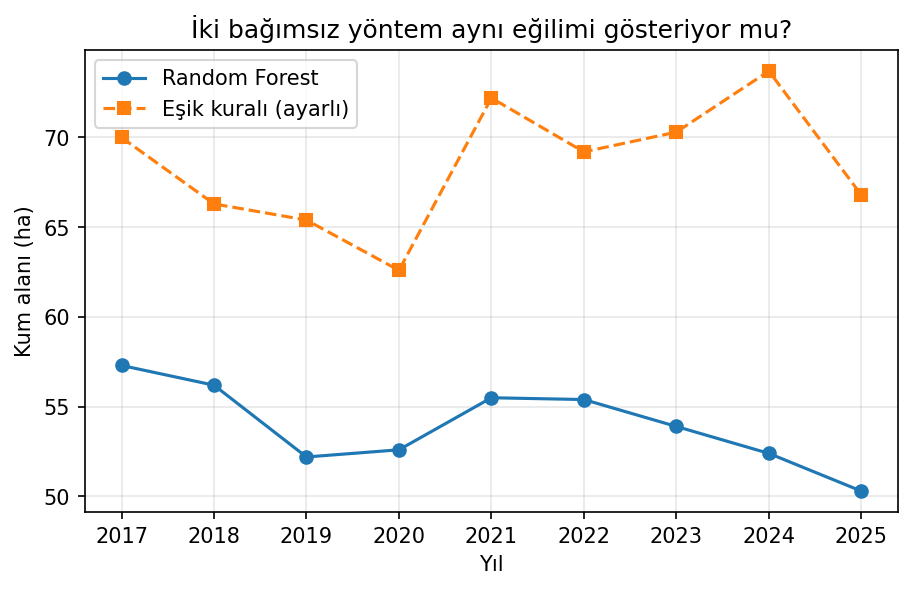
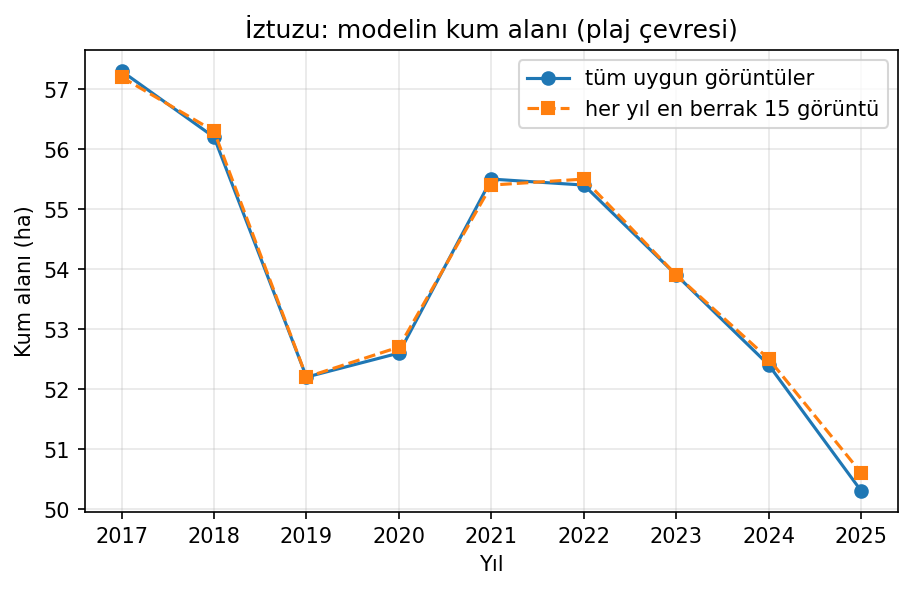

# İztuzu Kumsalı: Sentinel-2 ile Su / Kum / Kara Sınıflandırması

Açık uydu verisiyle (Sentinel-2) İztuzu Kumsalı'nı (Dalyan, Muğla) **su, kum ve diğer kara** olarak sınıflandıran ve iki yöntemi karşılaştıran küçük bir çalışma. Caretta caretta yuvalama alanının uydudan izlenmesi üzerine planlanan proje için yapılan ön denemedir.

**Ana soru:** Basit bir spektral eşik kuralı mı, yoksa kendi etiketlediğim noktalarla eğitilmiş bir Random Forest mi kumsalı daha iyi ayırıyor? Sonuç yıllar arası bir kum alanı eğilimi için güvenilir mi?

## Özet bulgular

- Random Forest, ayarlanmış eşik kuralından kumsalın iki yarısında da daha yüksek doğruluk verdi.
- Sınıflandırma doğruluğu yüksek olsa da **yıllık toplam kum alanı eğilimi yönteme duyarlı** çıktı. İki yöntem aynı eğilimi göstermedi, bu yüzden bu çalışmadan "kumsal daraldı" sonucu çıkarılamaz.
- Sonraki adım toplam alan yerine kumsal boyunca ölçülü dilimlerde genişlik hesaplamak.

## Veri

| | |
|---|---|
| Uydu verisi | Sentinel-2 Level-2A (`COPERNICUS/S2_SR_HARMONIZED`), Google Earth Engine |
| Dönem | Her yıl 1 Haziran - 1 Eylül, bulut oranı %10'dan az, medyan birleşik görüntü |
| Bölge | Boylam 28,59-28,65, enlem 36,76-36,82 |
| Etiketler | Görüntü üzerinde elle işaretlenmiş 478 nokta, aynı piksele düşenler tekilleştirilince **473** |
| Sınıf dağılımı | su: 140, kum: 165, diğer kara: 168 |
| Özellikler | B2, B3, B4, B8, B11, B12 bantları ve NDWI, MNDWI, NDVI indeksleri |

Bu depoda yuva verisi veya yuva konumu bulunmaz. Yalnızca uydu görüntüsü ve kendi etiketlerim kullanıldı.

## Yöntem

1. Noktalar piksel ortasına konarak üç sınıfta etiketlendi (Earth Engine Code Editor).
2. Etiketli piksellerin bant ve indeks değerleri okundu, aynı piksele düşen tekrarlar çıkarıldı.
3. **Mekânsal doğrulama:** Kumsal, kum noktalarının enlem medyanına göre ikiye bölündü. Bir yarıda eğitilip diğerinde test edildi, sonra tersi yapıldı. Böylece yan yana duran noktalar ezberlenemedi.
4. Karşılaştırılan yöntemler:
   - **Eşik kuralı:** MNDWI eşiğinin üstü su, değilse NDVI eşiğinin üstü diğer kara, kalanı kum. Eşikler önce tahmini değerlerle (0 ve 0,3), sonra eğitim yarısında ayarlanarak denendi.
   - **Random Forest:** 300 ağaç, dengeli sınıf ağırlığı, 9 özellik.
5. Her iki yöntem 2017-2025 yaz görüntülerine uygulandı ve plaj çevresindeki kum alanı hesaplandı.

## Sonuçlar

### Sınıflandırma doğruluğu (kumsalın iki yarısında çapraz test)

| Eğitim → Test | Yöntem | Doğruluk | F1 (kum) |
|---|---|---|---|
| Kuzeybatı → Güneydoğu | Eşik (ayarsız) | 0,842 | 0,838 |
| Kuzeybatı → Güneydoğu | Eşik (ayarlı) | 0,941 | 0,932 |
| Kuzeybatı → Güneydoğu | Random Forest | 0,995 | 1,000 |
| Güneydoğu → Kuzeybatı | Eşik (ayarsız) | 0,881 | 0,845 |
| Güneydoğu → Kuzeybatı | Eşik (ayarlı) | 0,893 | 0,819 |
| Güneydoğu → Kuzeybatı | Random Forest | 0,989 | 0,994 |

Ayarlı eşikler iki yarıda farklı çıktı (NDVI eşiği 0,20 ve 0,05). Bu, tek bir eşiğin kumsalın her yerinde aynı çalışmadığını gösteriyor.

### Yıllık kum alanı (plaj çevresi, hektar)

| Yıl | 2017 | 2018 | 2019 | 2020 | 2021 | 2022 | 2023 | 2024 | 2025 |
|---|---|---|---|---|---|---|---|---|---|
| Random Forest | 57,3 | 56,2 | 52,2 | 52,6 | 55,5 | 55,4 | 53,9 | 52,4 | 50,3 |
| Eşik (ayarlı) | 70,0 | 66,3 | 65,4 | 62,6 | 72,2 | 69,2 | 70,3 | 73,7 | 66,8 |

Random Forest 2017'den 2025'e yaklaşık %12'lik bir düşüş gösteriyor, ancak yıldan yıla dalgalanma da büyük. Eşik kuralı belirgin bir düşüş göstermiyor ve iki yöntem arasında yaklaşık 15-20 hektar mutlak fark var. Bu yüzden toplam alan bir **gösterge** olarak okunmalı, eğilim kanıtı olarak değil. Görüntü sayısı kontrolü (her yıl en berrak 15 görüntü) sonucu değiştirmedi.

## Sınırlılıklar

- **Çözünürlük:** Sentinel-2'de bir piksel 10 m. Kumsal genişliği birkaç ila onlarca piksel. Birkaç metrelik değişimler ölçüm gürültüsünün altında kalabilir.
- **Kolay test noktaları:** Noktalar piksel ortasına, net örneklere kondu. Doğruluk değerleri kum-su ve kum-bitki sınırındaki karışık pikselleri iyi temsil etmiyor, kıyı çizgisi doğruluğunu ölçmüyor.
- **Tek etiketleyici, tek model, tek görüntü dönemi:** Etiketler tek kişi tarafından yapıldı, model 2025 görüntüsüyle eğitildi. Diğer yıllar için bağımsız etiket yok.
- **Plaj çevresi maskesi:** 2025 Random Forest kum maskesinin 150 m genişletilmişi kullanıldı. Bu, eski yıllarda bu alanın dışına taşan kumu saymaz ve yöntemler arası karşılaştırmayı tam bağımsız yapmaz.
- **"Kum" sınıfı yuvalama bandı değildir:** Islak kum, kumulun bitkisiz kısımları ve göl kıyısındaki açık renkli şerit de sınıfa girmiş olabilir.
- **Deniz koşulları:** Dalga ve deniz seviyesi kıyı çizgisini görüntü tarihine göre oynatabilir. Bu çalışmada kontrol edilmedi.
- **Sahada doğrulama yok.**

## Sonraki adımlar

- Kıyı çizgisi ile bitki/kumul sınırı arasındaki kum genişliğini kumsal boyunca ~50 m'lik dilimlerde hesaplamak.
- Dalga ve deniz seviyesi sakin olan tarihlerin görüntülerini seçmek (Open-Meteo Marine).
- Eğilimi gürültüyle kıyaslayan bir istatistik testi kullanmak (örneğin Theil-Sen eğimi).
- Bağımsız saha ölçümleriyle doğrulamak.

## Çalıştırma

1. [Google Earth Engine](https://earthengine.google.com) hesabı ve bir Google Cloud projesi gerekir (ticari olmayan kullanım için ücretsiz).
2. `notebooks/iztuzu_kiyi_cizgisi.ipynb` dosyasını Google Colab'da açın.
3. Notebook'taki `project='...'` değerini kendi Earth Engine proje kimliğinizle değiştirin.
4. Etiket noktaları Earth Engine asset'i olarak tutuluyor ve bu depoda yok. Kendi etiketlerinizi aynı sınıf kodlarıyla oluşturabilirsiniz: 0 = su, 1 = kum, 2 = diğer kara.

## Teknolojiler

Python, Google Earth Engine, scikit-learn, pandas, matplotlib, Google Colab
